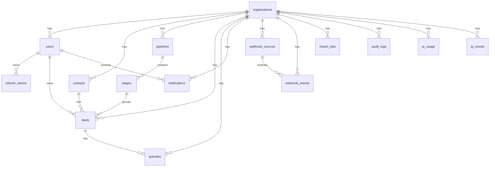

# Data Model — Pulse CRM

**Source**: spec v0.1 section 6, with SCR-001…SCR-007 applied.
**Database**: PostgreSQL 16 + Prisma. All timestamps are stored as `timestamptz` in UTC. IDs are UUID v4
(except `audit_logs`, which uses a bigint identity for write throughput).

## 1. Tenant principles

This is the most important part of the model. Every business table has `org_id`, and relationships use
**composite foreign keys** `(org_id, ...)` so the database itself rejects cross-organization references.

```text
organizations(id)
  └── users(org_id, id)
  └── contacts(org_id, id)
  └── pipelines(org_id, id)
        └── stages(org_id, pipeline_id, id)
  └── deals(org_id, id)
        ├── contact_id  → contacts(org_id, id)
        ├── pipeline_id → pipelines(org_id, id)
        ├── stage_id    → stages(org_id, pipeline_id, id)
        └── owner_id    → users(org_id, id)
```

Conventions:

1. Every business table has `org_id uuid not null`.
2. Parent tables expose a unique `(org_id, id)` so they can be the target of composite foreign keys.
3. Repositories **must** take `orgId`; never use `findUnique({ id })` for business data.
4. Updates/deletes use `updateMany/deleteMany` with `orgId` and check `count`; 0 rows → 404.
5. `$queryRaw` must be parameterised and include `org_id = $1`; reviewed manually.
6. Background jobs carry `orgId` in the payload and re-check it before writing.

## 2. ERD



## 3. Enums

| Enum | Values |
| --- | --- |
| `UserRole` | `ADMIN`, `MANAGER`, `SALES` |
| `DealStatus` | `OPEN`, `WON`, `LOST` |
| `ActivityType` | `NOTE`, `CALL`, `EMAIL`, `TASK` |
| `NotificationType` | `DEAL_ASSIGNED`, `DEAL_MOVED`, `TASK_DUE`, `TASK_OVERDUE`, `IMPORT_DONE`, `WEBHOOK_FAILED`, `AI_READY` |
| `WebhookEventStatus` | `RECEIVED`, `PROCESSING`, `PROCESSED`, `FAILED`, `DEAD` |
| `ImportStatus` | `PENDING`, `PROCESSING`, `COMPLETED`, `PARTIAL`, `FAILED` |
| `AiFeature` | `DEAL_SUMMARY`, `EMAIL_DRAFT`, `LEAD_SCORE`, `RAG_QA` |
| `AiRunStatus` | `SUCCESS`, `ERROR`, `TIMEOUT`, `CACHED` |

## 4. Tables

### 4.1 `organizations`

| Column | Type | Constraint |
| --- | --- | --- |
| `id` | uuid | PK, default app UUID |
| `name` | text | not null, 1–120 characters |
| `plan` | text | not null, default `'free'` |
| `currency` | char(3) | not null, default `'VND'`, ISO 4217 |
| `timezone` | text | not null, default `'Asia/Ho_Chi_Minh'` |
| `created_at` | timestamptz | not null, default now |

Index: none beyond the PK.

### 4.2 `users`

| Column | Type | Constraint |
| --- | --- | --- |
| `id` | uuid | PK |
| `org_id` | uuid | FK → organizations, not null |
| `email` | text | not null, normalised to lowercase/trimmed |
| `password_hash` | text | not null, Argon2id |
| `name` | text | not null, 1–120 |
| `role` | UserRole | not null, default `SALES` |
| `active` | boolean | not null, default true |
| `created_at`, `updated_at` | timestamptz | not null |

Constraints/indexes:

- `unique (lower(email))` system-wide — FR-01 “email not used yet”; login needs no org selector.
- `unique (org_id, id)` — composite FK target.
- `index (org_id, role, active)`.

> Trade-off: an email belongs to exactly one org. Supporting the same person in several orgs later would require
> changing the membership model; that needs a new ADR.

### 4.3 `refresh_tokens`

| Column | Type | Constraint |
| --- | --- | --- |
| `id` | uuid | PK |
| `user_id` | uuid | FK → users, not null |
| `token_hash` | text | not null, unique; HMAC-SHA256(token, pepper) |
| `family_id` | uuid | not null |
| `expires_at` | timestamptz | not null |
| `revoked_at` | timestamptz | null |
| `replaced_by_id` | uuid | null, FK → refresh_tokens |
| `user_agent` | text | null |
| `ip` | inet | null |
| `created_at` | timestamptz | not null |

Index: `(user_id, family_id)`, `(family_id)`, `(expires_at)`.
No `org_id` here: this is an auth table bound to the user, not business data — and the user already carries one.

### 4.4 `contacts`

| Column | Type | Constraint |
| --- | --- | --- |
| `id` | uuid | PK |
| `org_id` | uuid | not null |
| `name` | text | not null, 1–200 |
| `email` | text | null, lowercase/trimmed |
| `phone` | text | null, 0–30 |
| `company` | text | null, 0–200 |
| `source` | text | null, 0–50 (webhook, import, manual, …) |
| `owner_id` | uuid | null; composite FK `(org_id, owner_id)` → users |
| `deleted_at` | timestamptz | null (soft delete) |
| `created_at`, `updated_at` | timestamptz | not null |

Constraints/indexes:

- `unique (org_id, lower(email)) where deleted_at is null and email is not null` — prevents duplicates while
  still allowing the email to be reused after a delete.
- `unique (org_id, id)`.
- `index (org_id, owner_id)`, `index (org_id, deleted_at)`.
- GIN trigram: `lower(name)`, `lower(coalesce(email,''))`, `lower(coalesce(company,''))`.

### 4.5 `pipelines`

| Column | Type | Constraint |
| --- | --- | --- |
| `id` | uuid | PK |
| `org_id` | uuid | not null |
| `name` | text | not null, 1–80 |
| `created_at` | timestamptz | not null |

Constraints: `unique (org_id, id)`, `unique (org_id, lower(name))`.

### 4.6 `stages`

| Column | Type | Constraint |
| --- | --- | --- |
| `id` | uuid | PK |
| `org_id` | uuid | not null (SCR-001) |
| `pipeline_id` | uuid | not null; composite FK `(org_id, pipeline_id)` |
| `name` | text | not null, 1–80 |
| `position` | numeric(20,10) | not null |
| `is_won` | boolean | not null, default false |
| `is_lost` | boolean | not null, default false |
| `created_at`, `updated_at` | timestamptz | not null |

Constraints/indexes:

- `check (not (is_won and is_lost))`.
- `unique (org_id, pipeline_id, id)` — target for the deal FK `(org_id, pipeline_id, stage_id)`.
- `unique (org_id, id)`.
- Partial unique: `unique (pipeline_id) where is_won`; `unique (pipeline_id) where is_lost` — each pipeline has
  at most one won and one lost stage.
- `unique (pipeline_id, lower(name))`.
- `index (org_id, pipeline_id, position)`.

### 4.7 `deals`

| Column | Type | Constraint |
| --- | --- | --- |
| `id` | uuid | PK |
| `org_id` | uuid | not null |
| `contact_id` | uuid | not null; composite FK `(org_id, contact_id)` |
| `pipeline_id` | uuid | not null; composite FK `(org_id, pipeline_id)` |
| `stage_id` | uuid | not null; composite FK `(org_id, pipeline_id, stage_id)` |
| `title` | text | not null, 1–200 |
| `value` | numeric(14,2) | not null, default 0, check ≥ 0 |
| `currency` | char(3) | not null; the service forces it to `org.currency` |
| `owner_id` | uuid | not null; composite FK `(org_id, owner_id)` |
| `expected_close` | date | null |
| `status` | DealStatus | not null, default `OPEN` |
| `lost_reason` | text | null |
| `position` | numeric(20,10) | not null |
| `version` | integer | not null, default 1 |
| `closed_at` | timestamptz | null (SCR-002) |
| `created_at`, `updated_at` | timestamptz | not null |

Check constraints:

```sql
check (value >= 0)
check (currency ~ '^[A-Z]{3}$')
check (status <> 'LOST' or (lost_reason is not null and length(btrim(lost_reason)) > 0))
check (status =  'LOST' or lost_reason is null)
check ((status = 'OPEN') = (closed_at is null))
```

Indexes:

- `(org_id, stage_id, position, id)` — kanban.
- `(org_id, owner_id)`.
- `(org_id, status, closed_at)` — win rate.
- `(org_id, expected_close)` — forecast.
- `(org_id, contact_id)`.
- `unique (org_id, id)`.

> `status` is derived from the stage by the service; clients never send it. `closed_at` is set/cleared
> accordingly. `version` increments on every successful update/move and drives the optimistic lock.

### 4.8 `activities` (including tasks)

| Column | Type | Constraint |
| --- | --- | --- |
| `id` | uuid | PK |
| `org_id` | uuid | not null |
| `deal_id` | uuid | not null; composite FK `(org_id, deal_id)` |
| `type` | ActivityType | not null |
| `content` | text | not null, 1–10,000 |
| `due_at` | timestamptz | null; required when `type='TASK'` |
| `done_at` | timestamptz | null |
| `assignee_id` | uuid | null; required when `type='TASK'`; composite FK |
| `created_by` | uuid | not null; composite FK |
| `created_at`, `updated_at` | timestamptz | not null |

Checks:

```sql
check (type <> 'TASK' or (due_at is not null and assignee_id is not null))
check (type =  'TASK' or done_at is null)
```

Indexes:

- `(org_id, deal_id, created_at desc)` — timeline.
- Partial `(org_id, assignee_id, due_at) where type='TASK' and done_at is null` — overdue.
- `unique (org_id, id)`.

> Tasks have no table of their own (SCR-004). `GET /tasks` is a projection: `type='TASK'`, filtered by
> assignee/done_at/due_at. `PATCH /tasks/:id` only sets `done_at`/`content`/`due_at`/`assignee_id`.

### 4.9 `notifications`

| Column | Type | Constraint |
| --- | --- | --- |
| `id` | uuid | PK |
| `org_id` | uuid | not null |
| `user_id` | uuid | not null; composite FK |
| `type` | NotificationType | not null |
| `payload` | jsonb | not null, minimal, no secrets or unnecessary PII |
| `dedupe_key` | text | null |
| `read_at` | timestamptz | null |
| `created_at` | timestamptz | not null |

Constraints/indexes:

- Partial unique `(org_id, user_id, type, dedupe_key) where dedupe_key is not null` — anti-spam.
- `index (org_id, user_id, read_at, created_at desc)`.
- `unique (org_id, id)`.

### 4.10 `webhook_sources`

| Column | Type | Constraint |
| --- | --- | --- |
| `id` | uuid | PK |
| `org_id` | uuid | not null |
| `name` | text | not null, 1–80 |
| `public_key` | text | not null, unique, 32+ URL-safe characters |
| `secret_ciphertext` | text | not null; AES-256-GCM (SCR-003) |
| `secret_last4` | char(4) | not null |
| `previous_secret_ciphertext` | text | null; the old secret during the grace period (ADR-011) |
| `previous_expires_at` | timestamptz | null; when the grace period ends (default: rotate + 24h) |
| `default_owner_id` | uuid | null; composite FK |
| `active` | boolean | not null, default true |
| `rotated_at` | timestamptz | null |
| `created_at` | timestamptz | not null |

Constraints: `unique (org_id, id)`; `CHECK ((previous_secret_ciphertext IS NULL) = (previous_expires_at IS NULL))`.
`secret_ciphertext` is never returned by the API; the plaintext is returned **once** on create/rotate. On rotation
the old secret moves to `previous_*` and stays accepted until `previous_expires_at` (24h), after which requests
are rejected with 401.

### 4.11 `webhook_events`

| Column | Type | Constraint |
| --- | --- | --- |
| `id` | uuid | PK |
| `org_id` | uuid | not null |
| `source_id` | uuid | not null; composite FK `(org_id, source_id)` |
| `idempotency_key` | text | not null |
| `status` | WebhookEventStatus | not null, default `RECEIVED` |
| `payload` | jsonb | not null |
| `attempts` | integer | not null, default 0 |
| `last_error` | text | null |
| `received_at` | timestamptz | not null |
| `processed_at` | timestamptz | null |

Constraints/indexes:

- `unique (org_id, idempotency_key)` — FR-11.
- `index (status, received_at)`, `index (org_id, source_id, received_at desc)`.
- `unique (org_id, id)`.

### 4.12 `import_jobs`

| Column | Type | Constraint |
| --- | --- | --- |
| `id` | uuid | PK |
| `org_id` | uuid | not null |
| `created_by` | uuid | not null; composite FK |
| `status` | ImportStatus | not null, default `PENDING` |
| `total` | integer | not null, default 0 |
| `success` | integer | not null, default 0 |
| `failed` | integer | not null, default 0 |
| `file_name` | text | not null |
| `file_hash` | char(64) | not null; SHA-256 of the raw file |
| `error_report_key` | text | null; storage key, not a public URL |
| `started_at`, `finished_at` | timestamptz | null |
| `created_at` | timestamptz | not null |

Index: `(org_id, created_at desc)`, `(org_id, file_hash, created_at desc)`.
`unique (org_id, id)`.

### 4.13 `audit_logs`

| Column | Type | Constraint |
| --- | --- | --- |
| `id` | bigint identity | PK |
| `org_id` | uuid | not null |
| `actor_id` | uuid | null (system jobs) |
| `entity` | text | not null (Contact, Deal, User, …) |
| `entity_id` | text | not null |
| `action` | text | not null (CREATE/UPDATE/DELETE/MOVE/ASSIGN/… ) |
| `before` | jsonb | null, already redacted |
| `after` | jsonb | null, already redacted |
| `request_id` | text | null |
| `ip` | inet | null |
| `created_at` | timestamptz | not null |

Index: `(org_id, created_at desc)`, `(org_id, entity, entity_id, created_at desc)`,
`(org_id, actor_id, created_at desc)`.
Append-only at the application layer; there is no `updated_at`.

### 4.14 `ai_usage`

| Column | Type | Constraint |
| --- | --- | --- |
| `id` | uuid | PK |
| `org_id` | uuid | not null |
| `user_id` | uuid | not null |
| `feature` | AiFeature | not null |
| `model` | text | not null |
| `input_tokens` | integer | not null, ≥ 0 |
| `output_tokens` | integer | not null, ≥ 0 |
| `cost_usd` | numeric(12,6) | not null, ≥ 0 |
| `cache_hit` | boolean | not null, default false |
| `latency_ms` | integer | not null |
| `status` | AiRunStatus | not null |
| `request_id` | text | null |
| `created_at` | timestamptz | not null |

Index: `(org_id, created_at)`, `(org_id, user_id, created_at)` — quota accounting.

### 4.15 `ai_results`

| Column | Type | Constraint |
| --- | --- | --- |
| `id` | uuid | PK |
| `org_id` | uuid | not null |
| `user_id` | uuid | not null |
| `feature` | AiFeature | not null |
| `entity_type` | text | not null (`DEAL`, `CONTACT`) |
| `entity_id` | uuid | not null |
| `input_hash` | char(64) | not null; SHA-256 of the canonical input |
| `output` | jsonb | not null; text/json depending on the feature |
| `score` | integer | null; check 0–100 |
| `reason` | text | null |
| `model` | text | not null |
| `created_at` | timestamptz | not null |

Index: `(org_id, feature, input_hash, created_at desc)` — cache; `(org_id, entity_type, entity_id, created_at desc)` — history.
`unique (org_id, id)`.

## 5. Business integrity rules (service level)

| Rule | Enforced by |
| --- | --- |
| `deals.currency = organizations.currency` | DealService |
| `deal.stage` belongs to `deal.pipeline` | Composite FK |
| `status` is derived from the stage | DealService.move/update |
| `LOST` requires `lost_reason` | DTO + service + DB check |
| `closed_at` only when WON/LOST | Service + DB check |
| Every pipeline has ≥ 1 won and ≥ 1 lost stage | PipelineService |
| Cannot delete a stage/pipeline that still has deals | PipelineService → 409 |
| `version` increments on every mutation | DealRepository |
| Contact email unique while not soft-deleted | Partial unique + service error mapping |
| A task must have due_at + assignee | DTO + DB check |
| Notifications never duplicate a dedupe_key | Partial unique + upsert |
| Webhook idempotency | Unique + `ON CONFLICT` insert |
| Import never duplicates an email | Unique + skip/record error |
| Audit in the same transaction | AuditService(tx) |

## 6. Migration & seed

Planned migration order:

1. `0001_init`: extensions `pg_trgm`, `unaccent`, `pgcrypto`; organizations (currency/timezone), users, refresh_tokens, **audit_logs**; indexes.
2. `0002_crm_core`: contacts, pipelines, stages, deals (including `closed_at`); composite FKs; check constraints; indexes.
3. `0003_workflow`: activities, notifications; indexes.
4. `0004_integrations`: webhook_sources/events, import_jobs.
5. `0005_governance_ai`: ai_usage, ai_results; indexes.

> `audit_logs` must exist from `0001_init` because C4 requires auditing from the very first mutation in 002;
> 007 only reads it, adds indexes and handles retention.

The seed (`prisma/seed.ts`) must be idempotent:

- 2 orgs (`Acme`, `Globex`), each with Admin/Manager/2 Sales; test password `Password123!`.
- 1 pipeline “Sales Pipeline” per org with New/Qualified/Proposal/Won/Lost.
- Perf dataset: 10,000 contacts, 5,000 deals, 20,000 activities; deterministic (fixed faker seed).
- Never used in production: guarded by `NODE_ENV=production` plus `ALLOW_SEED`; the perf dataset additionally
  requires `SEED_PERF=true` (see `docs/quickstart.md` section 4).

## 7. Suggested retention (not implemented in the MVP)

| Data | Keep | Note |
| --- | --- | --- |
| `audit_logs` | 12 months | Monthly delete job; requires approval |
| `webhook_events.payload` | 30 days | Keep the metadata longer |
| `import_jobs.error_report_key` | 7 days | Delete the storage file |
| `ai_results` | 90 days | Keep `ai_usage` for cost accounting |
| Expired `refresh_tokens` | 30 days | Periodic cleanup |
| Soft-deleted contacts | not deleted yet | Needs a separate policy |

## 8. Why these indexes?

- The kanban reads by `(org_id, stage_id, position, id)` — no full-table sort.
- Win rate/forecast filter on `status, closed_at` / `expected_close`.
- Overdue tasks use a small partial index that only contains open tasks.
- Trigram serves Vietnamese `ILIKE '%term%'`; 10k rows easily reach p95 < 300ms.
- Webhook idempotency is a unique index, so conflicts are handled by the DB (race-safe).
- Audit indexes serve FR-13 by entity/time/actor.
- AI quota indexes on `(org_id, created_at)` and `(org_id, user_id, created_at)`.
